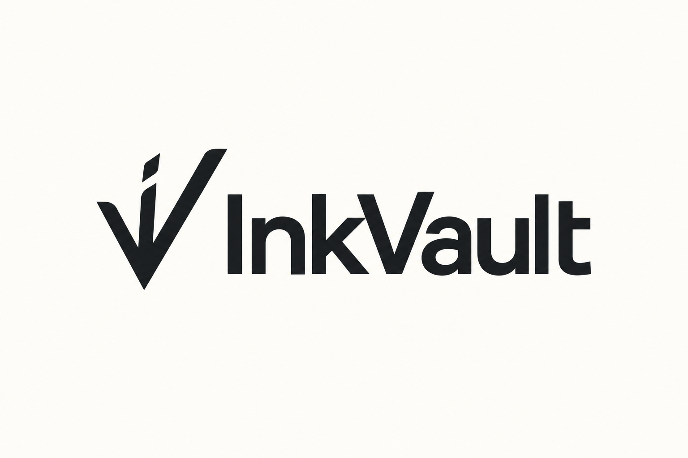

# InkVault

<p align="center">
  
</p>

**Local-first, user-owned persistent memory for your AI conversations, browsing, and work.**

Keep the context behind your work: what you asked, what you learned, and the pages you opened.
InkVault preserves supported AI sessions and the browser history you choose in a local SQLite vault,
so you can find them again after the original tools have cleared their history.

Search your vault yourself in the **Memory Atlas**, or connect an AI tool through **MCP** so it can retrieve
past context when you ask. Optional Windows screen capture adds a timeline of the apps you use and text
from apps you choose. You control the sources, the vault folder, and the backups.

InkVault is free and MIT licensed. No account or telemetry. InkVault itself does not upload your archive.
If you connect an AI client, memories returned to that client may be sent to its model provider under
that client's settings.

## Start your vault

You need [uv](https://docs.astral.sh/uv/getting-started/installation/) and a terminal.
Copy your supported local sessions and chosen browser history into a vault:

```bash
uvx --from git+https://github.com/sandoreclegane/inkvault inkvault sync
```

In a terminal, InkVault asks which browser profiles are yours before reading their history.
It downloads the search model on first use (about 130 MB). Then open the Atlas:

```bash
uvx --from git+https://github.com/sandoreclegane/inkvault inkvault dashboard
```

Search for something you remember, select a result, and read it in context. Add
[`inkvault schedule`](#keep-it-up-to-date) to refresh and back up your vault nightly, or
[connect your AI tools](#connect-your-ai-tools) to search it from a conversation.

**Have a Pieces archive to save?** See [Rescuing from Pieces](#rescuing-from-pieces).

## What InkVault preserves

With a nightly schedule, InkVault reads the session files Claude Code and Codex already keep on disk, and the history of the
browser profiles you chose, and copies in what's new: what you asked, what the assistant answered, what each session
was called, and which pages you opened. Your AI tools can then search what they helped you with, and what you were
reading, last month or last year, long after the original files are gone.

- **Claude Code**: every project, from `~/.claude/projects`. Synced messages stay in your vault after source cleanup.
- **Codex**: every session it saved, from `~/.codex/sessions`.
- **Claude desktop app** (agent mode, Windows): including prompts only its audit log kept.
- **Your browsers**: Chrome, Edge, Comet, Brave, Arc, Vivaldi, Opera and Firefox, only the profiles you say are yours
  ([how](#your-browser-history)). Kept past the browser's own cleanup.

Only what's new since the last sync is added. Tool output and attachments are left out, and sign-in codes and
tokens are cleaned out of web addresses (see [Privacy](#privacy)).

## What you get

- **A vault you own**: preserved sessions, chosen browser history, optional screen activity, and any rescued
  Pieces records in one local SQLite file, `vault.db`. Keep it independently of the tools that produced it.
- **Search for your AI tools**: an MCP server with `search_memories` (keyword + meaning, merged), `timeline`
  ("what was I doing in March?"), `get_memory`, and `memory_stats`.
- **Memory Atlas**: open it with `inkvault dashboard` (or the **InkVault Atlas** icon from `inkvault dashboard --shortcut`
  on Windows). It shows your year: active hours per day (hover a day for what it was about), when you work, how your
  projects connect, projects and topics over time, top apps and sites. Every chart has a table view. A **Search** view
  finds things across your vault and opens the original in a reader. It runs on this computer only (127.0.0.1, a
  private link, stops when idle) and needs no internet.
- **Daily Light (v0.3.2)**: a daily quotation from 32 curated public-domain passages, chosen by your local date,
  without using your history. Hide it for the current Atlas session. When indexed activity exists on today's date
  in an earlier year, **On this day** opens it in Search. You can also browse any date range by setting both
  From and To without entering a keyword. These date-browsing additions are Atlas-only; MCP tools are unchanged.
- **Your Claude Code, Codex and Claude desktop sessions**: your prompts and the replies, side by side with your
  other preserved history, searchable as chats (named like `Claude Code · project: title`), and part of the timeline, the
  digests and the dashboard.
- **Your browser history**: pages you opened in Chrome, Edge, Comet, Brave, Arc, Vivaldi, Opera or
  Firefox, from the browser profiles you say are yours. Visits already copied stay in the vault after the browser
  removes them. Searchable as `web`, on the timeline, in the digests and on the dashboard.
- **Screen capture** (optional, Windows): a timeline of the windows you used, plus the text of the windows in
  apps you choose. No images are kept. See [Screen capture](#screen-capture-windows).
- **Daily digests** (optional): a 2-3 sentence summary of each day, written by a *local* model through
  [Ollama](https://ollama.com). Summarize your preserved activity without sending it to a hosted model.

## Connect your AI tools

**Claude Code**

```bash
claude mcp add inkvault --scope user -- uvx --from git+https://github.com/sandoreclegane/inkvault inkvault serve
```

**Codex** (`~/.codex/config.toml`)

```toml
[mcp_servers.inkvault]
command = "uvx"
args = ["--from", "git+https://github.com/sandoreclegane/inkvault", "inkvault", "serve"]
```

**Hermes, Claude Desktop, and other MCP clients**: run `uvx --from git+https://github.com/sandoreclegane/inkvault inkvault serve` over stdio.

Then ask: *"What was I working on the week of March 10?"*, *"Find that retry helper I saved"*, *"When did I last look at the Stripe dashboard?"*

## Your browser history

A browser profile can belong to someone else, so InkVault reads none until you choose:

```bash
inkvault browsers
```

It lists every profile it finds (browser, name, signed-in email) and asks which are yours. `sync` and `rescue`
ask too when they find a new one; the nightly run never asks, and skips profiles you haven't chosen. If someone
else starts using a browser on this computer, run `inkvault browsers` again: InkVault notices a profile that was
replaced on Windows and macOS, and when a profile's signed-in account changes, but it can't always tell.

- `inkvault browsers --no "chrome/Profile 2" --forget` stops copying a profile and removes what was copied, even
  after the browser is uninstalled.
- `inkvault browsers --skip-site mybank.com` never keeps that site or its subdomains, and removes what's there.

Removing rebuilds search and the dashboard and deletes the digests for each removed visit's day (in UTC) and the day
either side. If it's interrupted, the next `inkvault sync`, `inkvault index` or nightly run finishes it, and search
stays off until then. It can't recall an answer your AI tool already received, or a dashboard tab that's already
open. The nightly backups still hold the removed visits until they rotate out (7 nights).

**What's kept:** each page's address and title, and when you opened it. Before anything is stored, InkVault
removes parts of addresses that carry sign-in codes, tokens, signed links, password-reset tokens, and your email
or username. Searches (`?q=…`) stay. This catches the common shapes, not every possible secret. Copying happens
while the browser runs, so the newest few visits can wait for the next sync.

Safari isn't supported yet (macOS blocks reading it without Full Disk Access).

## Screen capture (Windows)

With `inkvault watch`, you can add a local timeline of foreground windows and read text from apps you choose.
Screen capture stays off until you install the watcher. It's Windows-only for now; on macOS and Linux
`inkvault watch` says so and exits.

**What it records**

- **A timeline, everywhere.** Every foreground window becomes a *stretch*: the app, a cleaned title, and when it
  started and ended. A window you only flick through isn't kept, and time you're away (no input for 5 minutes, or the
  screen is locked) isn't counted.
- **Text, in apps you choose.** After you settle on a window for 30 seconds, InkVault reads its text (Windows' own
  OCR, on your machine) and stores it if it changed. A given window is read at most every 2 minutes.
- **No images, ever.** The window image exists in memory just long enough to read, and is never written to disk.
- Before anything is stored, secrets in titles and text (API keys, tokens, JWTs, `password: ...` values) are masked
  and URLs are cleaned. This catches the common shapes, not every possible secret.

**Which apps get text.** By default: Comet and Edge; Claude, ChatGPT, Perplexity and Codex; Windows Terminal, VS
Code and Cursor; Notion, Obsidian and Notepad; and the Microsoft 365 apps (Word, Excel, PowerPoint, Outlook, new
Outlook, OneNote). Every other app is timeline-only. Two groups are off until you say yes, and `--install` asks:

- **Messaging apps** (Discord, WhatsApp, Telegram, Teams, LinkedIn). Reading them stores other people's messages and
  names, and Discord's title is the name of the person you're talking to. Off unless you answer yes.
- **Chrome.** Its window title is just the page and "Google Chrome", with no profile name, so InkVault can't tell
  your Chrome profiles from anyone else's. Off unless you answer yes.

Without a terminal (for example a scripted install) both stay off. You can add or remove any app yourself.

**Everyone using the Windows account is captured.** The watcher runs in the account that installed it, from sign-in.
If anyone else uses that account, what they do is recorded too. Use a separate Windows account for anyone who
shouldn't be.

**Never captured.** Password managers and Windows' sign-in and permission prompts (1Password, Bitwarden, KeePass,
KeePassXC, the lock screen, UAC) are skipped entirely: no stretch, no text. So are windows whose title contains
`InPrivate`, `Incognito` or `Private Browsing`, and anything you add with `--never-app` or `--never-title`.

### Install

```bash
uv tool install "inkvault[screen]"
inkvault watch --apps       # preview: shows the settings, records nothing
inkvault watch --install    # asks about messaging apps and Chrome, then starts at every sign-in
```

`--apps` is a preview: it shows which apps get text and which are never captured, and starts nothing. `--install`
registers a Task Scheduler task that starts the watcher at sign-in, restarts it if it stops, and checks it's really
running before it says "screen capture is on". It also adds two desktop shortcuts: *Pause screen capture (1 hour)*
and *Resume screen capture*. Without the `screen` extra (or without an OCR language installed in Windows) the
watcher still records the timeline, and `inkvault status` says why there's no text.

### Controls

| Command | Does |
|---|---|
| `inkvault watch --apps` | Show which apps get text and which are never captured. Changes nothing |
| `inkvault watch --install` | Start screen capture now and at every sign-in |
| `inkvault watch --stop` | Stop the running watcher (it starts again at the next sign-in) |
| `inkvault watch --pause 30m`, `1h` or `until-tomorrow` | Record nothing for a while. Works even during a nightly run |
| `inkvault watch --resume` | End a pause |
| `inkvault watch --add-app EXE` / `--remove-app EXE` | Read text in this app / back to timeline-only |
| `inkvault watch --never-app EXE` | Never record this app at all |
| `inkvault watch --never-title TEXT` | Skip any window whose title contains this text |
| `inkvault watch --reset-settings` | Back to the default settings |
| `inkvault watch --uninstall` | Stop the watcher and remove the sign-in task |

Settings live in `screen.json` in your InkVault folder, and the watcher picks up a change within a couple of
seconds. If the file is unreadable or invalid, it records nothing until it's fixed. Executable names ignore case.

### Searching it

- `timeline` shows screen activity **live**: a separate *Screen* section lists the windows in the range, newest
  first, including the one open now.
- `search_memories` finds screen text and window titles **after the nightly index** (or `inkvault index`); results
  say how far the index reaches. Use `source="screen"` for just screen activity.
- `get_memory` on a screen result shows the window's app, title and times, and its most recent text.
- `inkvault status` shows the watcher (running, paused, the app in front, last error), the sign-in task, and how many
  stretches and text reads were stored.
- The dashboard has a *Screen time* tile and a *Screen time by app* chart, and daily digests include screen time by
  app and the longest windows. Digests never include screen text.

### Forgetting

```bash
inkvault forget --screen --app Discord.exe
inkvault forget --screen --since "2026-10-12 09:00" --until "2026-10-12 11:30"
```

Times are your **local** time: a `--since` date means local midnight; an `--until` date includes that whole
day. Add `Z` or an offset for an exact instant. `--until` only goes with `--since`; `--app` removes all of an app.
Whole windows are removed: any stretch that overlaps the range goes, with all its text, and the command shows the
span it actually removed before it asks. Search, the dashboard and the digests are rebuilt without it. Nightly
backups made before then still hold it until they rotate out (7 nights), and an answer an AI tool already received
can't be recalled. Forgetting removes the past only: to stop recording an app, use `--never-app`.

### Limits

- **Banks and other sensitive sites.** Your browser-history `skip_sites` list holds domains, but a window title
  rarely contains one, so it can't be applied here. Put the text a bank's page title shows into `--never-title`
  (for example `--never-title "Example Bank"`).
- **Private windows.** The markers (`InPrivate`, `Incognito`, `Private Browsing`) are English. A localized browser
  may use other words, or none: add yours with `--never-title`.
- **A last moment.** InkVault checks the window just before and just after it reads it, and drops the text if it
  changed. A window that changes in the instant between the last check and the screen being drawn can't be caught.
- **Search is nightly, `timeline` is live.** New screen activity shows in `timeline` at once, and in search after the
  next index.
- **Store apps are timeline-only.** Windows Store (UWP) apps run inside a frame window that holds no text, so they
  show up in the timeline but their text isn't read.
- **Windows only.** macOS and Linux aren't supported.

## Keep it up to date

Keep supported sessions and chosen browser history up to date, rebuild search and the Atlas, and back up
your vault every night:

```bash
uvx --from git+https://github.com/sandoreclegane/inkvault inkvault schedule
```

This installs InkVault as a permanent `inkvault` command (with `uv tool install`, or updates an older one) and sets
up a nightly run at 03:00 with your system's own scheduler: Task Scheduler on Windows, launchd on macOS, a systemd
user timer (or cron) on Linux. If uv's tool folder isn't on your PATH, it tells you to run `uv tool update-shell`.

Each run exports new captures (if PiecesOS is running), copies new Claude Code and Codex sessions and new browser
history from the profiles you chose, and saves a dated copy of `vault.db` in `backups/` right after (the last 7 are
kept). Then it rebuilds search, writes new digests (if
Ollama is running) and rebuilds the dashboard. One step failing never stops the others. The computer is kept awake
while it runs (Windows and macOS). The export has a time budget: if a big backlog doesn't fit, the run stops
cleanly, backs up what it has, and the next night continues where it stopped.

`rescue` won't start while a nightly run is going; it tells you to try again. If a rescue is going when the nightly
run starts, the run waits for it (up to an hour); the rescue makes its own backup when it finishes.

`inkvault status` shows the schedule and how the last run went. It checks the scheduler itself, and says so if the
task was disabled, runs a different vault (there's one nightly run per computer user, so scheduling another vault
replaces it), or points at an InkVault install that's gone, and it flags a run that's overdue (none in 26 hours).
Each run is logged to `nightly.log` in your InkVault folder (or `nightly-fallback.log` next to it, if `nightly.log`
can't be written).

The schedule is tied to your vault folder, so if you started with `--home`, run `schedule` with the same `--home`.

If the computer is asleep or off at run time:

- **Windows** and **systemd** catch up when the computer is next on.
- **macOS** catches up after sleep, but not after a power-off.
- **cron** doesn't catch up.

The Windows task runs only while you're logged in. You can have the computer wake for the run:

- **Windows**: `schedule` asks. Your power plan must allow wake timers, and some laptops (Modern Standby) ignore them.
- **macOS**: `schedule` asks, then prints a one-time `sudo pmset repeat ...` command for you to run. It replaces any
  `pmset repeat` schedule you already have.
- **Linux**: a user timer can't wake the computer. systemd runs the timer while you're logged in;
  `loginctl enable-linger $USER` keeps it going always.

`inkvault schedule --at 02:30` picks another time, `--wake` or `--no-wake` skips the question, `--off` turns it off,
and `uv tool upgrade inkvault` updates InkVault.

## Commands

| Command | Does |
|---|---|
| `inkvault rescue` | Export, index, digest (if Ollama is running), build and open the dashboard |
| `inkvault export` | Copy everything out of PiecesOS. Safe to stop and re-run: it only adds what's new |
| `inkvault sync` | Copy new Claude Code and Codex sessions and browser history into the vault, then rebuild search |
| `inkvault browsers [--yes\|--no KEY] [--forget] [--skip-site HOST]` | Choose which browser profiles are yours, and sites never to keep |
| `inkvault index` | Rebuild search |
| `inkvault digest [--model M] [--redo]` | Daily digests with a local model (default `qwen3.5:4b`) |
| `inkvault dashboard` | Rebuild and open the Memory Atlas |
| `inkvault serve` | Run the MCP server |
| `inkvault status` | What's in your vault and where it lives, plus the schedule and last nightly run |
| `inkvault watch ...` | Screen capture (Windows): preview, install, pause, stop. See [Screen capture](#screen-capture-windows) |
| `inkvault forget --screen --app EXE` / `--since T --until T` | Remove screen capture from the vault |
| `inkvault schedule [--at HH:MM] [--wake\|--no-wake] [--off]` | Refresh and back up the vault every night |
| `inkvault nightly` | One refresh + backup now (what the schedule runs) |

## Privacy

This is your screen history, your chats, your browsing and your code. InkVault stores and searches your archive locally:

- Everything is stored in your app-data folder (`%LOCALAPPDATA%\InkVault`, `~/Library/Application Support/InkVault`,
  or `~/.local/share/inkvault`), or wherever `INKVAULT_HOME` points. Never inside the code folder.
- No telemetry, no accounts, no cloud.
- InkVault itself does not upload your archive. When you connect an AI client through MCP, memories returned to that
  client may be sent to its model provider under that client's settings. Choose your client and settings accordingly.
- One thing is downloaded: the search model (~130 MB from Hugging Face, once). The Atlas makes no network requests;
  its chart library (ECharts) is bundled, so it works offline.
- Digests use Ollama on your own machine. Skip them with `--no-digest`.
- From Claude Code and Codex sessions, InkVault keeps what you typed, what the assistant replied and session titles.
  Claude Code's replies include its tool calls, so a file it wrote is kept as written. Tool output (files it read,
  command output), pasted images and attachments are left out: they are most of each file and where secrets tend
  to show up. That lowers the risk; it can't rule it out, since anything you typed or pasted as text is kept.
- Browser history is read only from the profiles you choose (`inkvault browsers`), from a copy of the browser's
  file. InkVault keeps each page's address and title and when you opened it, after removing parts of addresses
  that carry sign-in codes, tokens, signed links, reset tokens, or your email or username. It can't promise to catch
  every secret. `inkvault browsers --skip-site` and `--no … --forget` remove what you don't want kept.
- Screen capture (Windows, off until you install it) keeps window titles and, for the apps you choose, their text.
  Images are never saved. Secrets in titles and text are masked before they are stored. See
  [Screen capture](#screen-capture-windows) for what it can't catch. The connected-client boundary above applies
  to screen memories too.
- Captured text and page titles were written by other people, apps and websites. The MCP server tells your AI tool
  to treat them as data, not instructions.

**Back up your vault.** It is one file: `vault.db` in your InkVault folder. Everything else can be rebuilt from it
with `inkvault index`.

## Rescuing from Pieces

InkVault began as a way to preserve Pieces memory. Rescue remains a supported use case; you can also
start and keep a vault without Pieces.

Keep PiecesOS installed and running until your export is safely complete:

```bash
uvx --from git+https://github.com/sandoreclegane/inkvault inkvault rescue
```

The export preserves the raw records PiecesOS returns: captures, summaries and their text, chats,
snippets, tags, websites, and people.

**It takes a while.** PiecesOS hands records over at about 8 per second, so a year of captures (~100,000) takes
around 3-4 hours. Leave it running, or press **Ctrl+C** anytime: InkVault keeps everything saved so far and opens
a dashboard of what you have. Run the same command again later and it picks up where it left off.

## Good to know

- **Your projects** on the dashboard are detected from recurring phrases in your session titles. To choose your own,
  create `themes.txt` in your InkVault folder with lines like `Website = website|landing page|stripe` and run
  `inkvault dashboard`.
- **Topics** come from the topic tags Pieces wrote on each session summary. *Ongoing* topics recur across months;
  *bursts* are concentrated in a few weeks. They appear after the next `inkvault index` (part of `rescue` and the
  nightly run). Thanks to Anthony at Pieces for the idea.
- **Claude Code and Codex sessions** are read from `~/.claude/projects` and `~/.codex/sessions` (or
  `CLAUDE_CONFIG_DIR` and `CODEX_HOME` if you set them). `rescue` and the nightly run do this too; `inkvault sync`
  does it on its own, and works without Pieces. Only what's new since the last sync is read.
- **Claude desktop app sessions** (agent mode, Windows) are read from the app's own folder
  (`%LOCALAPPDATA%\Packages\Claude_*\LocalCache\Roaming\Claude\local-agent-mode-sessions`) and named
  `Claude desktop · project: title`. On macOS and Linux they aren't read yet.
- **PiecesOS port**: InkVault reads the port PiecesOS saved in its own config (`.port.txt`), then the port that worked
  last time, then tries 39300 and 1000. To force a port, set `INKVAULT_PIECES_PORTS` or pass `--pieces-ports`
  (for the nightly run: `inkvault --pieces-ports 39301 schedule`).
- **Pieces' own export tool**: Pieces said they'd send one. Use it too; two copies are better than one. Support
  for importing its format into InkVault is planned.
- Tested on Windows with PiecesOS 12.6.2 and a vault of 120,000 captures. macOS and Linux should work;
  reports are welcome. `inkvault schedule` has been tested end to end on Windows; on macOS and Linux it is
  covered by automated tests only so far, so a report from a real Mac or Linux machine would help a lot.

## Not affiliated with Pieces

InkVault is an independent project. "Pieces" is a trademark of its owner.

MIT licensed. Made by [T. Matthew Chase](https://github.com/sandoreclegane) / Logos 7.
